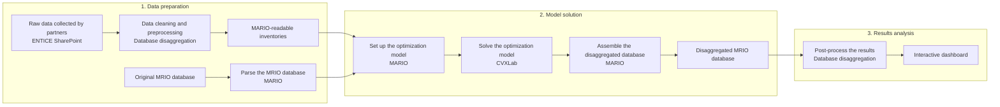

# Database disaggregation

Prepare collected data, disaggregate an input-output database and explore the
results for the **ENTICE** project. This repository connects partner data to
**MARIO** and **CVXLab**, and provides the preparation rules, workflow APIs and
interactive dashboards used around the model.

The workflow has three phases: **data preparation**, **model solution** and
**results analysis**. These match the *Overall workflow* diagram on slide 9 of
the MARIO workshop presentation (General Assembly, November 2026).

## Overall workflow



Two inputs meet at model construction: the **parsed MRIO baseline** and the
**prepared inventories**. Their regions, sector classifications and units must
agree. Data preparation uses the baseline's parent-sector budgets to reconcile
the collected observations before disaggregation.

| Component | Responsibility |
| --- | --- |
| **ENTICE SharePoint** | Stores partner deliveries, selected source data, classifications, prepared inventories and saved databases. |
| **This repository** | Cleans and maps collected data, prepares inventories and targets, coordinates the workflow, and produces analysis and dashboards. |
| **MARIO** | Parses and aggregates the baseline, constructs the optimization model, and assembles the resulting MRIO matrices. |
| **CVXLab** | Provides MARIO's optimization modelling and solver interface. MARIO declares it as a dependency; the development workflow uses matching checkouts. |

### 1. Data preparation

Partner templates and Purdue packages supply cost structures, production and
trade observations. The repository maps these inputs to the selected database,
applies explicit missing-data and reconciliation policies, and writes a
MARIO-readable `add_sectors.xlsx` plus an audit of sources and adjustments.
MARIO parses the baseline and aggregates its regions to the same geography.

Use `database_disaggregation.prepare_inputs(...)` for the collected-data API.
It returns the regional database, prepared workbook and audit directory.
Preparation does not solve the MRIO split. Target reconciliation may run its
own optimization. See the [preparation and notebook guide](docs/notebook-api.md).

### 2. Model solution

The prepared inventories and parsed baseline feed three separate calls:

1. **Build** the optimization problem with MARIO.
2. **Solve** it through CVXLab and the selected solver.
3. **Assemble** the solved flows into a disaggregated MARIO database.

The public `workflow` API exposes each stage. It currently builds **one problem
for the complete workbook**. For sequential insertion groups, failure handling
and checkpoint resumption, use MARIO's `add_sectors(...,
intermediate_steps=True)` and the controlled trial runner instead.
See [stage contracts and examples](docs/explicit-workflow.md) and the
[model and solver policy](docs/model-policy.md).

### 3. Results analysis

Save the resulting database, then compute checks and render an offline HTML
dashboard. The dashboard includes production, deliveries between regions, cost
structures and uses of each sector's output. It distinguishes new sectors,
residual parents and original sectors. When available, it shows the effective
production/trade constraints from the accepted step's archived workbook.

Saved results can be analysed without running the model again. Optional
comparisons with **EXIOBASE, EMERGING and GLORIA 2023** use explicit sector and
geography mappings. Verified reference caches support offline refreshes.
See [benchmarking and saved-result dashboards](docs/benchmarking.md) and the
[source-data dashboard](docs/source-data-explorer.md).

## Getting started

### Environment

Use Python **3.10 or later** and compatible MARIO/CVXLab checkouts. The separated
build, solve and assembly APIs currently require MARIO's
`codex/explicit-workflow` checkout. The saved sequential MRIO cases use the
versions recorded with their runs, including MARIO's `codex/mrio-memory`
workflow. Match these dependencies to the operation or checkpoint you select.

```bash
python -m pip install -e '/path/to/cvxlab'
python -m pip install -e '/path/to/MARIO'
python -m pip install -e '.[analysis,reconcile,benchmark]'
```

The distribution is `database-disaggregation`; the Python import is
`database_disaggregation`. Commercial solvers require their packages and
licences. Open solvers are supported where the selected formulation permits.

### Data and configuration

Set `ENTICE_DATA_ROOT` to the shared **Data split** folder, or edit `data_root`
in `paths.local.json`. The portable [path example](config/paths.example.json)
lists the input roles and relative paths. `ENTICE_CONFIG` can select a separate
configuration file. Licensed datasets and generated numerical databases are
supplied separately from this repository.

For the workshop, copy [the notebook settings](config/notebook.example.json) to
`examples/settings.json`, set the paths and open
[examples/disaggregation.ipynb](examples/disaggregation.ipynb). The notebook
loads a saved result for analysis. Preparation, model execution and export cells
are commented and can be enabled for a fresh run.

### One call for each stage

This example prepares a fresh case from configured shared data. Replace the
paths with your baseline, regional mapping and new output locations. Every
output directory must be new. Large cases require suitable RAM and a solver.

```python
from pathlib import Path
import mario
import database_disaggregation as disagg
from database_disaggregation import workflow

root = Path('/path/to/Data split')
geography = disagg.Geography.read('/path/to/regions.json')

# Data preparation: parse the baseline, then prepare matching regional inputs.
native_db = mario.parse_from_parquet(
    root / 'Database/_GTAP Power 2023/Cache',
    table='IOT', mode='flows', year=2023,
)
prepared = disagg.prepare_inputs(
    database=native_db, data_root=root, geography=geography,
    output_dir=Path('build/new-case/inputs'),
    missing_output='parent_share',
    missing_cost_structure='same_sector_then_parent',
    inconsistent_targets='reconcile',
)

# Model solution: build, solve and assemble are separate operations.
model = workflow.build_model(
    prepared.database, prepared.workbook, directory='build/new-case/model',
)
solution = workflow.solve_model(model, solver='CLARABEL')
result = workflow.assemble_database(solution)

# Results analysis: export the database and create the interactive dashboard.
exported = workflow.export_database(
    result, 'build/new-case/database', inputs=prepared.workbook,
)
workflow.build_dashboard(exported, 'build/new-case/dashboard.html')
```

A dashboard can also read an existing checkpoint and its matching benchmark:

```python
saved_run = root / 'Database/D2.8/20261028 1754 - 61 regions and 52 sectors'
disagg.reporting.write_dashboard(
    database=saved_run,
    output=Path('build/saved-result-dashboard.html'),
    benchmark=saved_run / 'benchmarking.json',
)
```

## Shared inputs and outputs

Paths below are relative to **Data split**. The
[shared-data guide](docs/shared-data/README.md) describes the complete layout.

| Location | Contents |
| --- | --- |
| `Data collection/Final` | Selected partner templates, value added and operational Purdue cost/output/trade packages. |
| `Data collection/Raw data` | Original deliveries, historical variants and source documents. |
| `Classifications` | Sector concordances, regional mappings and reviewed classifications. |
| `Database/_GTAP Power 2023` | Licensed baseline and cached matrices. |
| `Inventories/D2.8 inventories` | Prepared inputs and provenance for MRIO trials. |
| `Database/D2.8` | Saved disaggregated databases, checkpoints and reports. |
| `Inventories/D2.4 inventories` and `Database/D2.4` | Preserved historical D2.4 inputs and results. |

The current adapters target **GTAP Power 2023**. Other MARIO-readable databases
need matching source inventories, classifications and input conventions.
D2.4 uses historical insertion with `split=False`; the monetary MRIO workflow
uses `split=True`.

## Saved cases and interpretation

The latest documented shared case is
`Database/D2.8/20261028 1754 - 61 regions and 52 sectors`:
**61 regions, 52 added activities and 128 total sectors**. Seventeen of the
69 planned activities remain in their parents. Its benchmark uses its own
61-region, 76-sector baseline. The earlier 13-region result is preserved
separately; see [the extension case](docs/additional-sectors-13.md) and
[the 61-region report](docs/benchmarking.md#61-region-saved-result).

Constraint agreement and accounting diagnostics support review. They do not
establish economic plausibility. Signed flows and measured residuals remain
visible under the recorded `report_only` policy. Environmental **E remains
pending**. Numerical reference comparisons and generated reports remain in
shared project storage for internal ENTICE use.

## Commands and further documentation

Run commands from this checkout in the configured Python environment.

| Task | Entry point or guide |
| --- | --- |
| Prepare regional inventories | `python scripts/run_disaggregation.py --help` |
| Run or resume sequential model trials | `python scripts/run_model_trial.py --help` |
| Publish an existing trial to configured shared storage | `python scripts/publish_model_trial.py --help` |
| Benchmark a saved result against its baseline | `python scripts/benchmark_database.py --help` |
| Build reference concordances | `python scripts/build_reference_mappings.py --help` |
| Compare saved results with reference databases | `python scripts/benchmark_references.py --help` |
| Refresh reports from saved benchmarks | `python scripts/refresh_dashboards.py --help` |
| Refresh using audited reference caches | `python scripts/refresh_saved_dashboard.py --help` |
| Inspect sector and region definitions | `python scripts/registry.py --help` |
| Reproduce historical D2.4 inventories | [D2.4 evidence and replay guide](docs/baseline/README.md), branch `reference/d2.4` |
| Understand memory and scalability limits | [Memory study](docs/memory-study/README.md), [scalability](docs/scalability.md) |

`main` contains the consolidated preparation, workflow, analysis and reporting
APIs. Development worktrees remain available for their recorded experiments;
MARIO and CVXLab model changes live in their own repositories.

```text
config/                        portable examples and versioned policies
data/                          bundled registry, mappings and geography definitions
src/database_disaggregation/
  core/                        baseline access, geography, checks and benchmarks
  inventory/                   source-to-inventory conversion
  reconciliation/              preparation, targets and reconciliation policies
  workflow.py                  explicit build, solve, assembly and export stages
  analysis/                    monetary IO profiles and reference comparisons
  reporting/                   source-data and result dashboards
  export/                      historical inventory export and plots
examples/                      workshop notebook
scripts/                       preparation, trial, export and reporting commands
docs/                          methodology, case reports and evidence
manifests/                     captured source identities and storage history
build/                         ignored computational outputs
```

Run the Python suite with the matching MARIO/CVXLab checkouts importable:

```bash
python -m pytest tests -q
```

The tests include small numerical solves. Full shared MRIO runs are separate
experiments with their own data, solver settings and provenance records.
